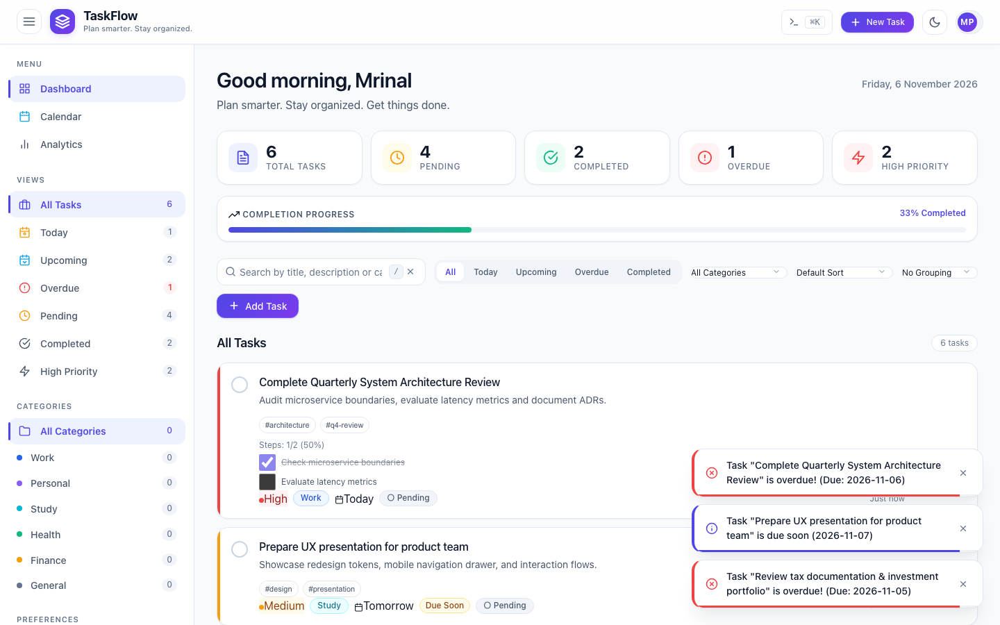
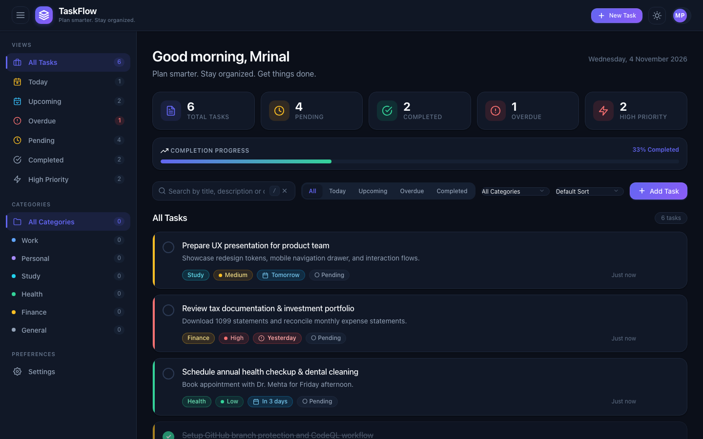
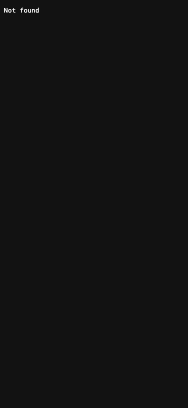
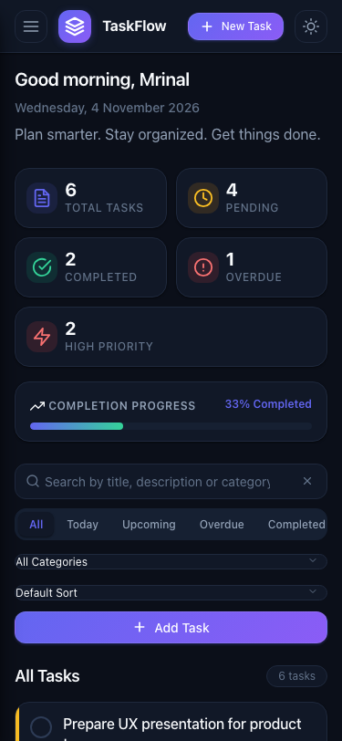
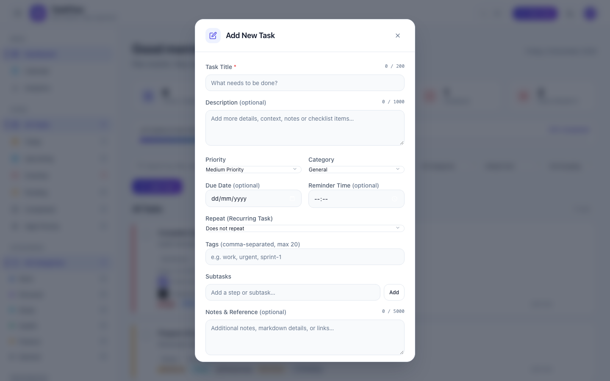
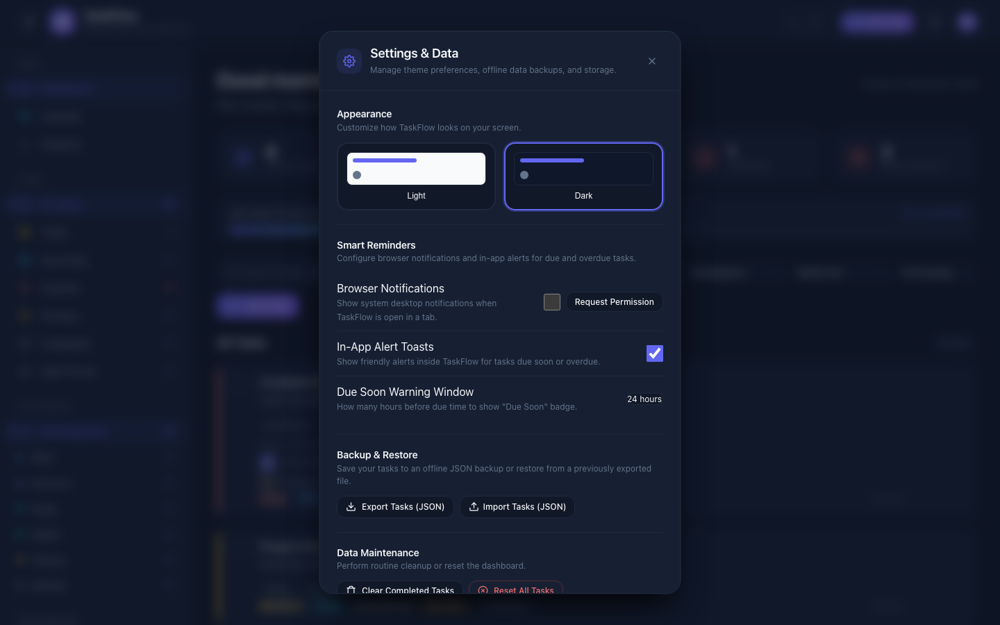

# TaskFlow

> **Plan smarter. Stay organized. Get things done.**

[](https://github.com/MRINALPRAKASHFSD/task_flow/actions/workflows/ci.yml)
[](https://github.com/MRINALPRAKASHFSD/task_flow/actions/workflows/codeql.yml)
[](LICENSE)
[](docs/LICENSE-CC-BY-4.0)
[](https://github.com/MRINALPRAKASHFSD/task_flow/generate)

TaskFlow is a lightweight, dependency-free to-do manager built with HTML5, CSS3 and Vanilla JavaScript.
It runs entirely in the browser, persists data in LocalStorage, and requires no build step, no server and no framework.

---

## Screenshots

| Desktop (Light Theme) | Desktop (Dark Theme) |
|:---:|:---:|
|  |  |

| Mobile (Light Theme) | Mobile (Dark Theme) |
|:---:|:---:|
|  |  |

| Task Creation & Edit Modal | Settings & Data Management |
|:---:|:---:|
|  |  |

---

## Features

| Feature | Description |
|---------|-------------|
|  Create Tasks | Add tasks with title, description, priority level, category, and optional due date. |
|  Edit Tasks | Modify existing tasks in place through the accessible task editor dialog. |
|  Delete Tasks | Remove tasks with an accessible modal confirmation dialog. |
|  Toggle Status | Mark tasks as completed or reopen them with a single click or keyboard shortcut. |
|  Priority | Assign Low, Medium, or High priority levels with visual indicators. |
|  Categories | Organize tasks into Work, Personal, Study, Health, Finance, or General. |
|  Due Dates | Set target dates with contextual status badges (Today, Tomorrow, Overdue, or formatted dates). |
|  Calendar View | Interactive Month, Week, and Day calendar grids with task indicators and date inspector. |
|  Recurring Tasks | Schedule recurring tasks with daily, weekly, monthly, or yearly cadence and duplicate prevention. |
|  Analytics & Trends | Real-time completion rates, velocity metrics, category breakdowns, and SVG trend charts. |
|  Smart Reminders | Proactive deadline tracking with the Web Notification API and in-app toasts. |
|  Subtask Checklists | Granular task checklists with live completion progress tracking (`0/N`). |
|  Tags & Filtering | Custom comma-separated tags with filterable chips and active filter indicators. |
|  Task Notes | Multiline contextual notes with character limits and expandable accordion view. |
|  Command Palette | Keyboard-driven search and action execution via `⌘K` / `Ctrl+K`. |
|  Dynamic Grouping | Group task lists by Priority, Status, Category, or Due Date. |
|  Multi-field Search | Real-time search across title, description, category, tags, and notes with clear button. |
|  Views & Filters | Filter by All Tasks, Today, Upcoming, Overdue, Completed, or High Priority. |
|  Sorting Modes | Order tasks by Newest first, Oldest first, Priority, Due Date, or Recently Updated. |
|  Statistics | Dashboard showing total, pending, completed, overdue, and high-priority counts. |
|  Progress Bar | Real-time completion percentage visualised with a progress bar. |
|  Versioned Persistence | Application state saved to LocalStorage with schema versioning and memory fallback. |
|  Timestamps | Creation and update timestamps displayed as relative or formatted date labels. |
|  Light / Dark Themes | Follows system OS preference on first visit; manual user preference is persisted. |
|  Mobile Responsive | Responsive layout with mobile navigation drawer, bottom sheets, and multi-view navigation. |
|  Accessible | Skip link, ARIA combobox, live announcements, full keyboard navigation, and focus trapping. |
|  Empty States | Context-sensitive messages when no tasks match the selected view or search query. |
|  Toast Notifications | Non-blocking feedback for every user action with 5-second auto-dismissal and queue. |
|  Validation | Client-side form validation with accessible inline error messages and live announcements. |
|  Backup & Restore | Export and import task data as JSON files directly from the Settings dialog. |

---

## Technology Stack

| Layer | Technology |
|-------|-----------|
| Markup | HTML5 (semantic elements) |
| Styles | CSS3 (custom properties, CSS Grid, Flexbox) |
| Logic | Vanilla JavaScript ES6+ (ES modules) |
| Persistence | Browser LocalStorage |
| Testing | Node.js built-in test runner (`node:test`) |
| CI | GitHub Actions |
| Security | GitHub CodeQL |
| Dependencies | **None** |

---

## Installation

### Option A — Open directly in a browser

No installation required. Clone or download the repository and open `index.html`:

```bash
git clone https://github.com/MRINALPRAKASHFSD/task_flow.git
cd task_flow
open index.html        # macOS
start index.html       # Windows
xdg-open index.html    # Linux
```

### Option B — Minimal dev server

If you need module imports to resolve correctly over HTTP (some browsers block ES modules from `file://`):

```bash
git clone https://github.com/MRINALPRAKASHFSD/task_flow.git
cd task_flow
npm start
# Open http://localhost:8080
```

Node.js ≥ 20 is required only for running the dev server and tests.

---

## Usage

### Adding a task

1. Click the **Add Task** button in the toolbar.
2. Enter a title (required) and an optional description.
3. Choose a priority (Low, Medium or High).
4. Click **Save Task**.

### Editing a task

- Hover over a task card and click the **Edit** button.
- Modify the fields in the modal and click **Save Task**.

### Completing a task

- Click the circle checkbox on the left of a task card.
- The task is marked completed and moves to the bottom of the list.

### Deleting a task

- Hover over a task card and click the **Delete** button.
- Confirm the deletion in the dialog.

### Filtering and searching

- Use the **All / Pending / Completed** tabs or the sidebar navigation.
- Type in the search box to filter tasks by title or description in real time.

### Switching themes

- Click the **Theme Toggle** button in the header (or press `T`) to switch between light and dark themes.
- Your preference is saved automatically.

---

## Project Architecture

```
taskflow/
├── index.html              Entry point — semantic HTML structure
├── css/
│   ├── variables.css       Design tokens (colours, spacing, typography)
│   ├── styles.css          Main application styles
│   └── responsive.css      Media queries and responsive adjustments
├── js/
│   ├── app.js              Application entry point — wires state, DOM and events
│   ├── tasks.js            Task domain model — create, update, delete, validate, stats
│   ├── storage.js          LocalStorage abstraction layer
│   ├── filters.js          Filter and sort logic
│   └── utils.js            Shared utility helpers (ID generation, date formatting, etc.)
├── tests/
│   ├── tasks.test.js       Task model, CRUD operations, deadlines, and stats
│   ├── filters.test.js     Filtering, search matching, and sorting logic
│   ├── storage.test.js     LocalStorage, schema versioning, and JSON import/export
│   └── accessibility.test.js Focusable selectors, focus trapping, and modal a11y
└── scripts/
    ├── check-syntax.js     Cross-platform Node.js syntax verification
    └── lint.js             Zero-dependency static style and safety linter
└── docs/
    ├── ARCHITECTURE.md     Detailed architecture documentation
    ├── USER_GUIDE.md       End-user documentation
    ├── DEVELOPMENT.md      Developer setup guide
    ├── THIRD_PARTY_NOTICES.md  Third-party attribution
    └── LICENSE-CC-BY-4.0  CC BY 4.0 license text for documentation
```

### Data model

```js
{
  id:          string,                     // Unique UUID or fallback identifier
  title:       string,                     // 1–200 characters (required)
  description: string,                     // 0–1000 characters (optional)
  priority:    'low' | 'medium' | 'high',  // Task priority
  category:    string,                     // 'Work' | 'Personal' | 'Study' | 'Health' | 'Finance' | 'General'
  status:      'pending' | 'completed',    // Status string
  completed:   boolean,                    // Synchronized boolean state
  dueDate:     string | null,              // 'YYYY-MM-DD' or null
  createdAt:   string,                     // ISO 8601 UTC timestamp
  updatedAt:   string,                     // ISO 8601 UTC timestamp
}
```

### Module responsibilities

| Module | Responsibility |
|--------|---------------|
| `tasks.js` | Pure functions — task creation, mutation, validation, deadline checks, and statistics. |
| `storage.js` | Versioned LocalStorage reads, writes, validation, and in-memory fallback. |
| `filters.js` | Pure multi-criteria filtering (status, category, search) and sorting. |
| `utils.js` | Shared helpers: date formatting, UUID generation, debouncing, and DOM node helpers. |
| `app.js` | Controller: state orchestration, event listeners, modal lifecycle, and DOM rendering. |

---

## Testing

```bash
# Run full verification (syntax checks + static linter + 127 unit tests)
npm run check

# Run all unit tests
npm test

# Run individual test files
npm run test:tasks
npm run test:filters
npm run test:storage
npm run test:accessibility

# Watch mode (re-runs on file change)
npm run test:watch
```

Tests use the **Node.js built-in test runner** — no external test framework is required.

---

## Contributing

Contributions are welcome! Please read [CONTRIBUTING.md](CONTRIBUTING.md) before opening a pull request.

Key points:
- Branch from `main` using `feat/`, `fix/`, `docs/`, etc.
- Follow [Conventional Commits](https://www.conventionalcommits.org/).
- Ensure `npm test` passes before submitting.
- Fill in the pull request template completely.

---

## Security

Please do **not** report security vulnerabilities as public GitHub issues.
Use [GitHub Security Advisories](https://github.com/MRINALPRAKASHFSD/task_flow/security/advisories/new).

See [SECURITY.md](SECURITY.md) for the full policy.

---

## Licensing

| Scope | License |
|-------|---------|
| Application source code (`js/`, `css/`, `index.html`, `tests/`) | [MIT](LICENSE) |
| Documentation (`docs/`, `README.md`, `CONTRIBUTING.md`, etc.) | [CC BY 4.0](docs/LICENSE-CC-BY-4.0) |
| Third-party assets | See [docs/THIRD_PARTY_NOTICES.md](docs/THIRD_PARTY_NOTICES.md) |

Copyright © 2026 Mrinal Prakash.

The MIT License permits use, modification and distribution of the source code
with attribution. The CC BY 4.0 license permits sharing and adapting the
documentation with attribution.

---

## Roadmap

See [ROADMAP.md](ROADMAP.md) for planned features including due dates, tags,
drag-and-drop reordering, subtasks and PWA support.

---

## Author

**Mrinal Prakash**
GitHub: [@MRINALPRAKASHFSD](https://github.com/MRINALPRAKASHFSD)

---

## Using as a Template

TaskFlow is configured as a **GitHub Template Repository**.
Click [**Use this template**](https://github.com/MRINALPRAKASHFSD/task_flow/generate) to create a new
repository with all files but a clean, unrelated Git history.

---

*Plan smarter. Stay organized. Get things done.*
